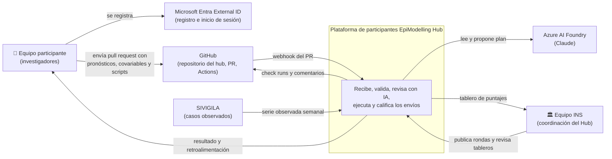

# Nivel 1 — Contexto

La plataforma es la puerta única de los equipos al Hub. El equipo se registra con Entra External ID y envía cada ronda como pull request en GitHub. Recibe la validación y el puntaje como check runs en ese mismo PR.

| Actor o sistema | Papel |
| --- | --- |
| Equipo participante | Envía pronósticos (CSV hubverse), covariables y scripts de R o Python |
| Equipo INS | Publica las rondas, la serie observada y revisa los tableros |
| GitHub | Repositorio del hub, pull requests y GitHub Actions |
| Entra External ID | Registro e inicio de sesión de los participantes |
| SIVIGILA | Fuente de la serie observada contra la que se califica |
| Azure AI Foundry (Claude) | Lee el código y propone el plan de ejecución |

## Fuente Mermaid

