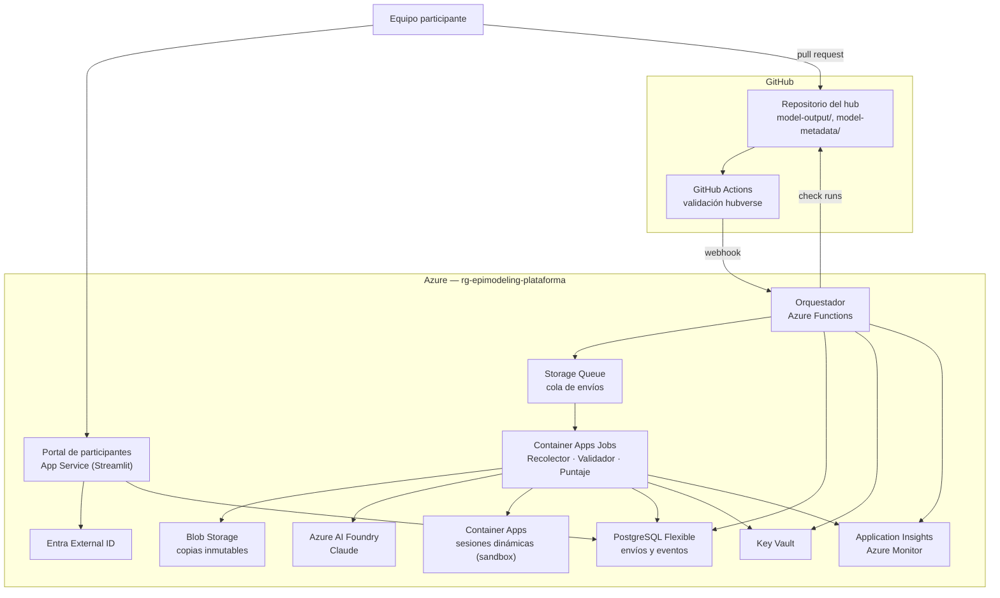

# Nivel 2 — Contenedores

| Contenedor | Tecnología | Responsabilidad |
| --- | --- | --- |
| Portal de participantes | App Service, Streamlit | Registro, perfil del equipo, estado de sus envíos y tablero |
| Repositorio del hub | GitHub | `model-output/`, `model-metadata/`, `hub-config/` |
| Validación en el PR | GitHub Actions | Revisión rápida del formato antes del webhook |
| Orquestador | Azure Functions + Storage Queue | Recibe el webhook, encola y mueve los estados |
| Jobs del pipeline | Container Apps Jobs | Recolector, Validador oficial, Agente revisor, Motor de puntaje |
| Sandbox | Container Apps, sesiones dinámicas | Ejecuta el código de los equipos sin internet |
| Almacenamiento | Blob Storage con retención inmutable | Copia de cada envío con SHA-256 |
| Base de datos | PostgreSQL Flexible Server | Equipos, envíos, `ejecucion_eventos`, puntajes |
| Secretos | Key Vault | Token de la GitHub App, claves de Foundry |
| IA | Azure AI Foundry | Despliegue de Claude para el Agente revisor |
| Observabilidad | Application Insights, Azure Monitor | Trazas, métricas y alertas |

## Fuente Mermaid

