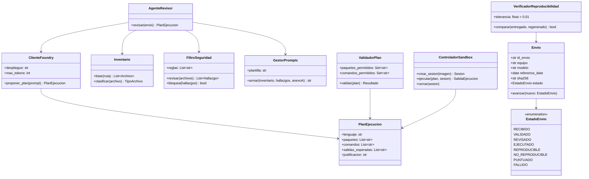

# Nivel 4 — Código del Agente revisor IA



El agente no ejecuta nada: devuelve un `PlanEjecucion`. Solo el `ControladorSandbox` corre comandos, y solo los de un plan que el `ValidadorPlan` aprobó.

Ejemplo de plan que devuelve Claude:

```json
{
  "lenguaje": "R",
  "paquetes": ["data.table", "INLA", "hubValidations"],
  "comandos": ["Rscript scripts/ajustar_modelo.R --corte 2026-11-14"],
  "salidas_esperadas": ["model-output/equipo-modelo/2026-11-14-equipo-modelo.csv"],
  "justificacion": "El script lee la serie y las covariables, ajusta un modelo INLA y escribe los 23 cuantiles."
}
```

## Fuente Mermaid


