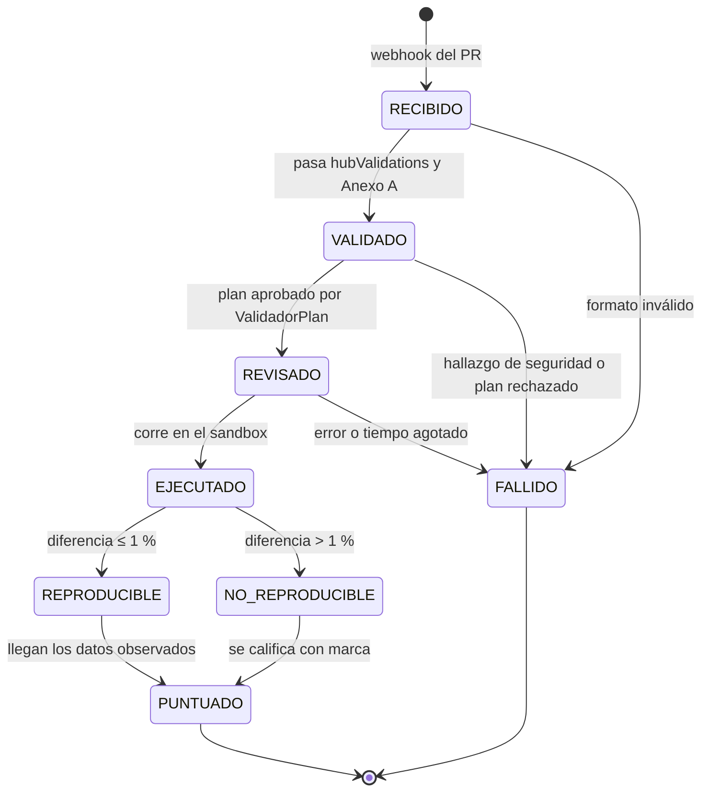

# Estados de un envío

Cada transición queda en `ejecucion_eventos` con la hora, el componente y el detalle. NO_REPRODUCIBLE se califica igual, pero queda marcado en el tablero.

## Fuente Mermaid

